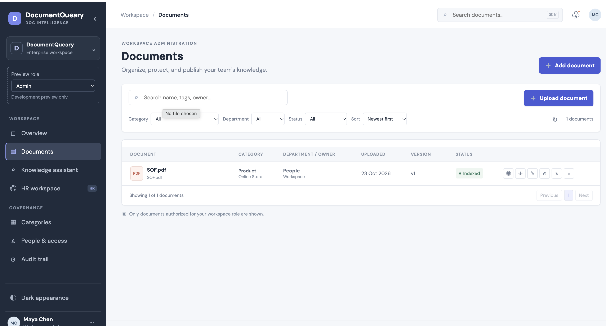
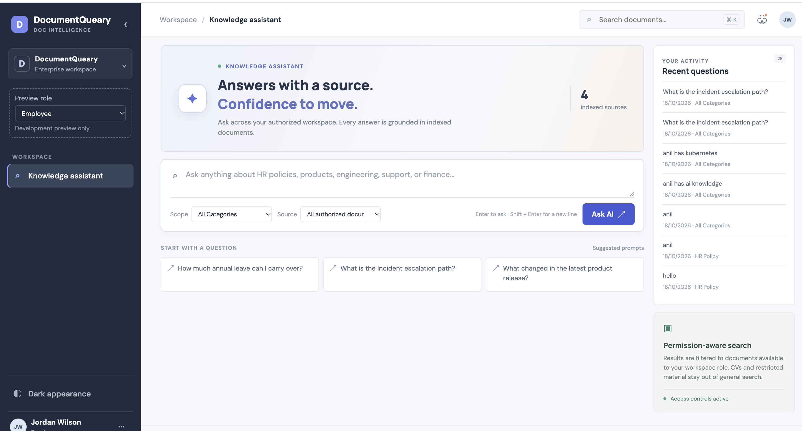

# DocuQuery — AI-Powered Document Q&A

DocuQuery full-stack Retrieval-Augmented Generation (RAG) application engineered as a high-impact Forward Deployed Engineer (FDE) use case. The platform transforms isolated, unstructured PDF repositories into dynamic, queryable knowledge bases by allowing users to securely upload documents, perform deep semantic searches, and receive grounded, natural-language answers.
By resolving core enterprise data challenges—such as text extraction, contextual chunking, and hallucination control—this application serves as a repeatable blueprint for deploying scalable AI solutions within secure client environments

---

## Features

- Upload and process PDF documents
- Extract text from uploaded PDFs
- Split documents into retrieval-friendly chunks
- Generate vector embeddings using Sentence Transformers
- Store embeddings with PostgreSQL + pgvector
- Perform semantic similarity search
- Ask natural-language questions about uploaded documents
- Generate RAG-based answers using an LLM
- Display retrieved source chunks and similarity scores
- List and select uploaded documents
- Delete documents and associated vector data
- Handle invalid, empty, and corrupted PDF uploads
- Roll back database changes when document processing fails
- Responsive React frontend
- Interactive FastAPI Swagger documentation

---

## Tech Stack

### Backend

- Python
- FastAPI
- SQLAlchemy
- PostgreSQL
- pgvector
- Sentence Transformers
- OpenAI API
- PyPDF
- Pydantic

### Frontend

- React
- Vite
- JavaScript
- React Markdown
- CSS

### Infrastructure

- Docker
- Docker Compose
- PostgreSQL with pgvector

---

## Architecture


## How RAG Works in DocuQuery

When a PDF is uploaded:

1. The PDF is saved by the FastAPI backend.
2. Text is extracted from the document.
3. The extracted text is divided into smaller chunks.
4. A vector embedding is generated for every chunk.
5. The chunks and embeddings are stored in PostgreSQL with pgvector.

When a user asks a question:

1. DocuQuery converts the question into an embedding.
2. pgvector compares the question vector with stored document vectors.
3. The most semantically relevant chunks are retrieved.
4. The retrieved chunks are provided to the LLM as context.
5. The LLM generates an answer using only the retrieved document context.
6. The frontend displays the answer together with its source chunks and similarity scores.

This allows DocuQuery to answer questions based on document meaning rather than simple keyword matching.

---

## API Endpoints

| Method | Endpoint | Description |
|---|---|---|
| `POST` | `/documents/upload` | Upload, process, chunk, and embed a PDF |
| `GET` | `/documents` | List uploaded documents |
| `GET` | `/documents/{document_id}` | Get document details |
| `DELETE` | `/documents/{document_id}` | Delete a document and associated data |
| `POST` | `/documents/{document_id}/search` | Perform semantic vector search |
| `POST` | `/documents/{document_id}/ask` | Ask a RAG-powered question |

FastAPI automatically provides interactive API documentation at:

```text
http://127.0.0.1:8000/docs
```

---

## Project Structure

```text
docuquery/
│
├── app/
│   ├── routers/
│   │   └── documents.py
│   │
│   ├── services/
│   │   ├── chunk_service.py
│   │   ├── embedding_service.py
│   │   ├── llm_service.py
│   │   └── pdf_service.py
│   │
│   ├── config.py
│   ├── database.py
│   ├── main.py
│   └── models.py
│
├── frontend/
│   ├── src/
│   │   ├── App.jsx
│   │   ├── App.css
│   │   └── index.css
│   │
│   └── package.json
│
├── uploads/
├── docker-compose.yml
├── requirements.txt
├── .gitignore
└── README.md
```

---

## Running the Project Locally

### Prerequisites

Make sure you have installed:

- Python 3
- Node.js
- Docker Desktop
- Git

---

### 1. Clone the repository

```bash
git clone https://github.com/vikasnair76/docuquery.git
cd docuquery
```

---

### 2. Create a Python virtual environment

```bash
python3 -m venv venv
source venv/bin/activate
```

---

### 3. Install backend dependencies

```bash
pip install -r requirements.txt
```

---

### 4. Start PostgreSQL + pgvector

```bash
docker compose up -d
```

---

### 5. Configure environment variables

Create a `.env` file in the project root.

Example:

```env
# Azure OpenAI Configuration
AZURE_OPENAI_ENDPOINT=https://azureopenaitestdehdgyedt.openai.azure.com/
AZURE_OPENAI_DEPLOYMENT=gpt-chat-latest
OPENAI_API_KEY=
# PostgreSQL Configuration
POSTGRES_USER=postgres
POSTGRES_PASSWORD=mysecurepassword123
POSTGRES_DB=docuquery_db
DATABASE_URL=postgresql://postgres:mysecurepassword123@db:5432/docuquery_db


```

Use the endpoint and deployment name from your Azure AI Foundry/OpenAI resource. Never commit your real `.env` file or API key to GitHub.

The Admin portal uses HTTP Basic authentication. The defaults are `admin` / `admin`; set a private `ADMIN_PASSWORD` before exposing the app beyond local development. Admins can upload PDF, TXT, DOC, DOCX, XLS, XLSX, and XLSM files, edit document titles, download, reprocess, inspect initial version records, and manage the document library. Regular users can select indexed documents and ask questions from the Knowledge assistant.

### Enterprise workspace capabilities

- Responsive workspace navigation includes dashboard, document library, knowledge assistant, HR workspace, categories, people/access preview, audit trail, and saved answers.
- Admin upload, deletion, metadata changes, downloads, reprocessing, and CV endpoints are enforced by the API using HTTP Basic credentials. For production, replace this development credential flow with Microsoft Entra ID/OIDC, enforce TLS, and configure a non-default secret.
- Employee document list, document lookup, and RAG retrieval exclude CVs, non-`All employees` access groups, and Confidential/Restricted records. HR CV upload and skill search require admin credentials; matching is exact text matching and is intended only to assist human review.
- Successful knowledge queries store only category and timestamp for aggregate analytics; query text is kept in the browser's local history, not on the server.
- Dashboard metrics, uploads, audit events, and CV search use live API data. If the document API is unavailable, the UI displays sample documents. The development role switch is compiled only in Vite development mode.

Some enterprise workflows are still preview-only: category edits and role/user changes are stored in the browser rather than a shared server-side directory; the Admin/Employee roles are not backed by an enterprise identity provider; version history currently records the initial upload but there is not yet a replacement/version-upload workflow; file preview and pagination are not implemented; CV extracted fields are entered/verified manually, and semantic matching is not enabled. Do not treat the local HTTP Basic defaults or browser role preview as production authorization.

---

### 6. Start the FastAPI backend

```bash
uvicorn app.main:app --reload --reload-dir app
```

Backend:

```text
http://127.0.0.1:8000
```

Swagger:

```text
http://127.0.0.1:8000/docs
```

---

### 7. Start the React frontend

Open another terminal:

```bash
cd frontend
npm install
npm run dev
```

Frontend:

```text
http://localhost:5173
```

---

## Example Workflow

1. Upload a PDF through the React interface.
2. Select the uploaded document.
3. Enter a question such as:

```text
What backend technologies does this candidate have experience with?
```

4. DocuQuery retrieves the most semantically relevant document chunks.
5. The LLM generates a grounded answer.
6. Relevant source chunks and similarity scores are displayed underneath the answer.

---

## Example RAG Response

```json
{
  "document_id": 6,
  "question": "What backend technologies does this candidate have experience with?",
  "answer": "The candidate has experience with Java, Spring Boot, Python, FastAPI, PostgreSQL and REST APIs.",
  "chunks_used": 3,
  "sources": [
    {
      "source": 1,
      "chunk_index": 0,
      "similarity": 0.5662
    }
  ]
}
```

---

## Error Handling

DocuQuery includes safeguards for:

- Unsupported file formats
- Empty file uploads
- Oversized documents
- Corrupted PDFs
- PDFs containing no readable text
- Embedding-generation failures
- LLM service failures
- Missing documents
- Failed database transactions

Document processing is performed transactionally so failed uploads do not leave incomplete database records or orphaned files.

---

## Future Improvements

Potential additions include:

- User authentication
- Multiple document collections
- Conversation history
- Streaming LLM responses
- OCR support for scanned PDFs
- Hybrid keyword + vector retrieval
- Reranking retrieved chunks
- Cloud object storage
- Production deployment
- Automated tests and CI/CD

---

## Screenshots

### Document Management

Upload, view, select, and delete PDF documents directly from the React interface.



### RAG Question Answering

Select a document and ask natural-language questions based on its contents.



### Source-Aware Retrieval

DocuQuery displays the document chunks and similarity scores used to support each generated answer.


